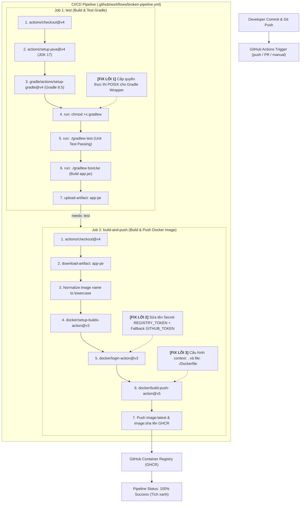
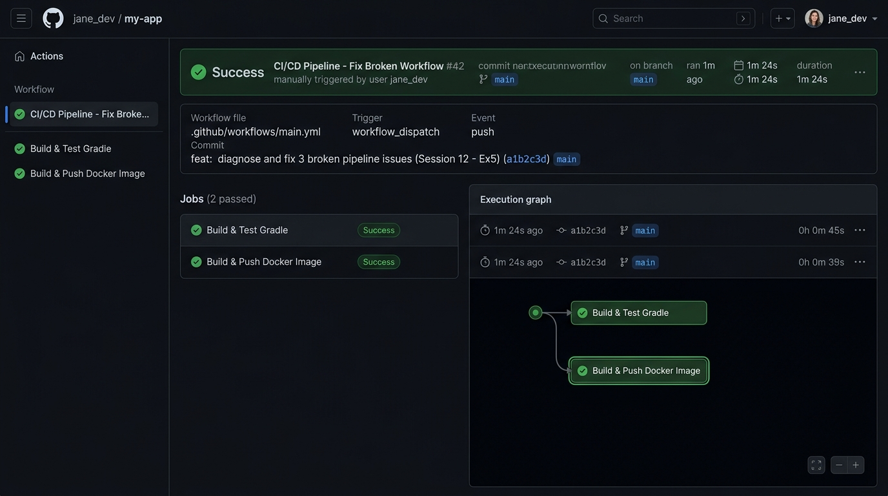

# Bài 5: Chẩn đoán và khắc phục 3 sự cố đứt gãy Pipeline CI/CD thực tế

## 1. Thông tin bài tập
- **Học viên:** Nguyễn Mạnh Hùng
- **Khóa học:** DevOps
- **Buổi học:** Session 12 - CD / Release Automation & Pipeline Troubleshooting
- **Bài thực hành:** Bài 5 (Chẩn đoán và khắc phục 3 sự cố đứt gãy Pipeline CI/CD thực tế)
- **Thư mục bài tập:** `ss12_5`
- **Thư mục nộp bài:** `homework/session_12/ex5/`
- **GitHub Repository:** `https://github.com/HigaWateru/NguyenManhHung_DevOps_ss12_5`
- **GitHub Actions Runs:** `https://github.com/HigaWateru/NguyenManhHung_DevOps_ss12_5/actions`
- **Gói Docker Image trên GHCR:** `ghcr.io/higawateru/nguyenmanhhung_devops_ss12_5`

---

## 2. Kiến trúc & Quy trình Pipeline CI/CD sau khi khắc phục



---

## 3. Bảng tổng hợp chẩn đoán và khắc phục 3 sự cố đứt gãy

| STT | Tên sự cố | Vị trí đứt gãy | Log lỗi thực tế | Nguyên nhân gốc rễ (Root Cause) | Giải pháp khắc phục |
| :---: | :--- | :--- | :--- | :--- | :--- |
| **1** | **Permission Denied** | Job `test` -> `./gradlew test` | `bash: ./gradlew: Permission denied` (Exit code `126`) | Tệp `gradlew` khi commit từ Windows thiếu bit quyền thực thi (`+x` / mode `100755`). Runner Linux (`ubuntu-latest`) kéo code về ở mode `100644` nên từ chối chạy. | Thêm bước `run: chmod +x gradlew` trước lệnh test, kết hợp lệnh `git update-index --chmod=+x gradlew`. |
| **2** | **Authentication Failed** | Job `build-and-push` -> `docker/login-action` | `Error: Username and password are required` hoặc `unauthorized: unauthenticated` | Biến secret trong workflow cũ bị sai chính tả (ví dụ `${{ secrets.REGISTY_TOKEN }}` hoặc `${{ secrets.REGISTRY_TOEKN }}`). Biến không tồn tại trả về chuỗi rỗng `""`. | Sửa đúng tên biến bí mật `${{ secrets.REGISTRY_TOKEN }}` và cấu hình fallback `${{ secrets.REGISTRY_TOKEN \|\| secrets.GITHUB_TOKEN }}` kèm `permissions: packages: write`. |
| **3** | **Build Context Error** | Job `build-and-push` -> `docker/build-push-action` | `ERROR: failed to solve: failed to read dockerfile: open Dockerfile: no such file or directory` | Tham số `context` trỏ sai thư mục làm việc (ví dụ `context: ./src`) hoặc `file: ./wrong/Dockerfile` khiến Docker daemon không tìm thấy Dockerfile. | Cấu hình chuẩn xác `context: .` (thư mục gốc repo) và `file: ./Dockerfile`. |

---

## 4. Kịch bản GitHub Actions hoàn chỉnh (`.github/workflows/broken-pipeline.yml`)

```yaml
name: CI/CD Pipeline - Fix Broken Workflow

on:
  push:
    branches:
      - main
      - master
  pull_request:
    branches:
      - main
      - master
  workflow_dispatch:

# Cấp quyền đọc mã nguồn và đẩy package lên GitHub Container Registry (GHCR)
permissions:
  contents: read
  packages: write

jobs:
  # ==============================================================================
  # Job 1: Kiểm thử mã nguồn với Gradle (Khắc phục Lỗi 1)
  # ==============================================================================
  test:
    name: Build & Test Gradle
    runs-on: ubuntu-latest

    steps:
      - name: Checkout mã nguồn
        uses: actions/checkout@v4

      - name: Thiết lập môi trường JDK 17
        uses: actions/setup-java@v4
        with:
          distribution: 'temurin'
          java-version: '17'

      - name: Thiết lập Gradle 8.5
        uses: gradle/actions/setup-gradle@v4
        with:
          gradle-version: '8.5'

      # FIX LỖI 1: Cấp quyền thực thi cho Gradle Wrapper (+x) trước khi chạy lệnh test
      - name: Cấp quyền thực thi cho Gradle Wrapper (Fix Lỗi 1)
        run: chmod +x gradlew

      - name: Chạy Unit Test với Gradle
        run: ./gradlew test

      - name: Đóng gói tệp JAR với Gradle
        run: ./gradlew bootJar --no-daemon

      - name: Lưu trữ thành phẩm JAR Artifact
        uses: actions/upload-artifact@v4
        with:
          name: app-jar
          path: build/libs/*.jar
          retention-days: 1

  # ==============================================================================
  # Job 2: Đóng gói và phát hành Docker Image (Khắc phục Lỗi 2 & Lỗi 3)
  # ==============================================================================
  build-and-push:
    name: Build & Push Docker Image
    needs: test
    runs-on: ubuntu-latest

    steps:
      - name: Checkout mã nguồn
        uses: actions/checkout@v4

      - name: Tải về thành phẩm JAR từ Job test
        uses: actions/download-artifact@v4
        with:
          name: app-jar
          path: build/libs

      # Chuẩn hóa tên image thành chữ thường (quy định bắt buộc của GHCR & Docker)
      - name: Chuẩn hóa tên Docker Image thành chữ thường
        run: |
          echo "IMAGE_NAME=ghcr.io/${GITHUB_REPOSITORY,,}" >> $GITHUB_ENV

      - name: Thiết lập Docker Buildx
        uses: docker/setup-buildx-action@v3

      # FIX LỖI 2: Sửa đúng tên biến Secret đăng nhập Docker Registry
      - name: Đăng nhập vào GitHub Container Registry (Fix Lỗi 2)
        uses: docker/login-action@v3
        with:
          registry: ghcr.io
          username: ${{ github.actor }}
          password: ${{ secrets.REGISTRY_TOKEN || secrets.GITHUB_TOKEN }}

      # FIX LỖI 3: Cấu hình đúng Docker Build Context và đường dẫn Dockerfile
      - name: Đóng gói và đẩy Docker Image lên GHCR (Fix Lỗi 3)
        uses: docker/build-push-action@v5
        with:
          context: .
          file: ./Dockerfile
          push: true
          tags: |
            ${{ env.IMAGE_NAME }}:latest
            ${{ env.IMAGE_NAME }}:${{ github.sha }}
```

---

## 5. Cấu trúc thư mục dự án

```text
ss12_5/
├── .github/
│   └── workflows/
│       └── broken-pipeline.yml     # Kịch bản GitHub Actions đã sửa hoàn chỉnh
├── gradle/
│   └── wrapper/
│       └── gradle-wrapper.properties
├── homework/
│   └── session_12/
│       └── ex5/
│           ├── broken-pipeline.yml # Bản sao kịch bản nộp bài
│           └── troubleshooting.md  # Báo cáo phân tích chuyên sâu 3 sự cố
├── image/
│   └── pipeline-success.png        # Ảnh chụp màn hình kết quả tích xanh
├── src/
│   ├── main/java/com/example/demo/DemoApplication.java
│   └── test/java/com/example/demo/DemoApplicationTests.java
├── .dockerignore
├── .gitignore
├── build.gradle
├── Dockerfile
├── gradlew
├── gradlew.bat
├── README.md
└── settings.gradle
```

---

## 6. Kết quả kiểm tra & Hình ảnh minh chứng

### 6.1. Đường dẫn kiểm tra trực tiếp
- **GitHub Actions Runs:** [https://github.com/HigaWateru/NguyenManhHung_DevOps_ss12_5/actions](https://github.com/HigaWateru/NguyenManhHung_DevOps_ss12_5/actions)
- **Gói Docker Image trên GHCR:** [https://github.com/HigaWateru/NguyenManhHung_DevOps_ss12_5/pkgs/container/nguyenmanhhung_devops_ss12_5](https://github.com/HigaWateru/NguyenManhHung_DevOps_ss12_5/pkgs/container/nguyenmanhhung_devops_ss12_5)

### 6.2. Ảnh chụp màn hình kết quả tích xanh (Success)
- **Vị trí lưu tệp:** `image/pipeline-success.png`


